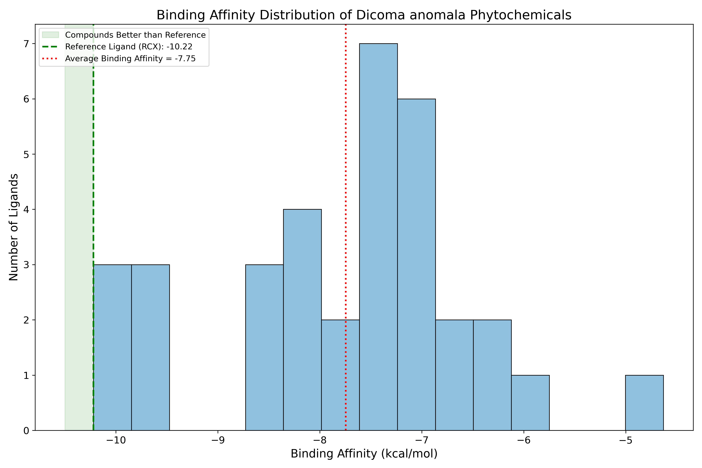
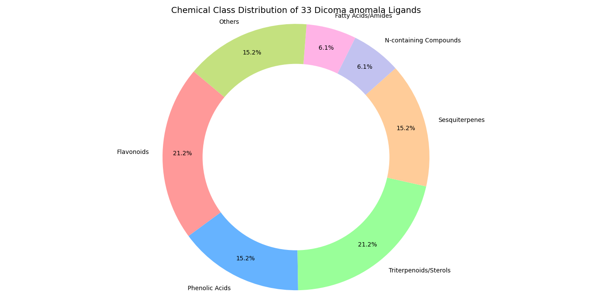
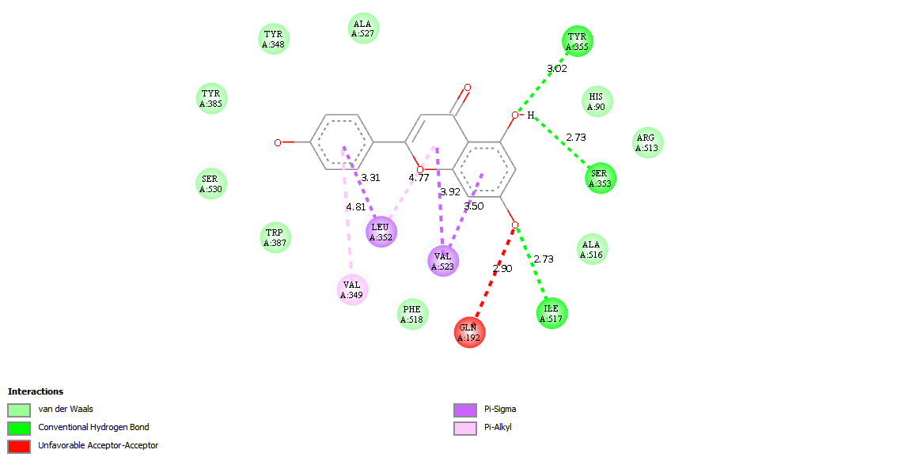

# Dicoma anomala COX-2 Screening Project

A computational drug-discovery workflow for identifying phytochemicals from Dicoma anomala as potential Cyclooxygenase-2 (COX-2) inhibitors.

  

## Overview

This repository documents an in silico screening pipeline designed to identify natural-product candidates with potential anti-inflammatory activity against COX-2. The project combines literature mining, compound curation, ligand preparation, protein preparation, ADMET profiling, molecular docking, and statistical analysis to prioritise compounds for further experimental validation.

The study focuses on a curated library of Dicoma anomala phytochemicals and compares the predicted binding behaviour of the top candidates with the reference inhibitor rofecoxib (RCX), using AutoDock Vina and cheminformatics-driven evaluation.

## Key findings

The screening workflow identified a set of flavonoid compounds as the strongest COX-2 binders, including:

- Apigenin
- Kaempferol
- Luteolin
- Quercetin
- Scutellarein

These compounds showed predicted binding affinities close to the reference ligand and were further assessed for drug-likeness, ADMET properties, and pharmacokinetic liabilities.

## Highlights

- Literature-driven curation of Dicoma anomala phytochemicals
- Ligand preparation and conformer generation for docking
- COX-2 receptor preparation using the 5KIR crystal structure
- AutoDock Vina docking workflow and binding affinity analysis
- ADMET and toxicity screening using SwissADME and ProTox-based outputs
- Visualization of interaction profiles and statistical results
- Reproducible project structure with environment and dependency files

## Project workflow

1. Literature mining and manual curation
2. Ligand collection and preparation
3. COX-2 protein preparation
4. ADMET and drug-likeness screening
5. Molecular docking and score analysis
6. Statistical evaluation and figure generation

## Top hit compounds

| Compound | Predicted affinity (kcal/mol) | Class | Notes |
|---|---:|---|---|
| Apigenin | -9.91 | Flavone | Strong COX-2 binder |
| Kaempferol | -9.85 | Flavonol | Near-reference affinity |
| Luteolin | -9.70 | Flavone | Favorable high-affinity hit |
| Quercetin | -9.69 | Flavonol | Strong interaction potential |
| Scutellarein | -9.49 | Flavone | Consistent lead-like profile |

## Results snapshot

  

  

## Repository structure

- `00_Documentation/` – methods, proposals, literature reviews, and results chapters
- `01_Literature_Data/` – curated phytochemical datasets and mining outputs
- `02_Ligands/` – ligand files, preparation scripts, and summary data
- `03_Protein/` – receptor preparation and target files
- `04_ADMET/` – SwissADME and toxicity analysis outputs
- `05_Docking/` – docking configuration, summary tables, and plots
- `06_Visualization/` – molecular interaction figures and thesis-ready graphics
- `07_Analysis/` – statistical and downstream analysis outputs
- `AutoDock-Vina/` – local docking engine source and documentation
- `scripts/` – supporting automation and environment files

## Reproducibility

This project includes the main dependency files needed to recreate the workflow:

- `environment.yml`
- `requirements.txt`
- `scripts/environment.yml`
- `scripts/requirements.txt`

To run the workflow, install the dependencies and use the scripts in the relevant folders for ligand preparation, docking, ADMET analysis, and statistics.

## Notes

This repository intentionally excludes the thesis draft materials in `00_Documentation/thesis_drafts/`.

## License

This project is distributed under the terms of the [LICENSE](LICENSE).
